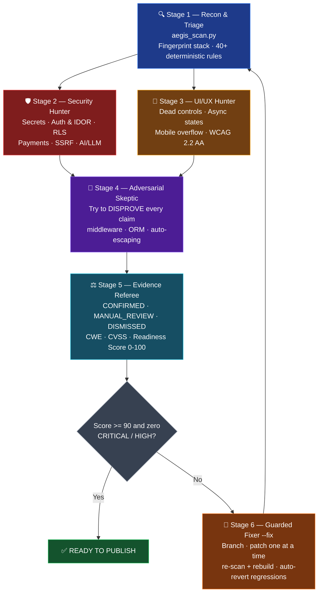

# 🛡️ Vibe Aegis (`vibe-aegis`)

**The Universal Pre-Launch Security & UI/UX Safeguard Loop for Vibe-Coded Apps.**

[](LICENSE)
[](scripts/aegis_scan.py)
[](bin/vibe-aegis.mjs)
[](https://github.com/Tacuns/vibe-aegis/actions/workflows/ci.yml)
[](CONTRIBUTING.md)
[](llms.txt)

---

## ⚡ Start in 2 Lines (Paste into Any AI Agent)

Open your project in **Claude Code, VS Code Copilot, OpenAI Codex, Cursor, Windsurf, Cline, Gemini CLI**, ChatGPT, Claude, Gemini, Perplexity or Grok — and paste this. Nothing to clone, nothing to install first:

```text
Read https://raw.githubusercontent.com/Tacuns/vibe-aegis/main/llms.txt and run the Vibe Aegis setup and 6-stage Security + UI/UX audit in this project.
```

That single URL teaches the agent the whole framework. For everything in one fetch, point it at [`llms-full.txt`](llms-full.txt) instead.

**Prefer a plugin?**

```text
/plugin marketplace add Tacuns/vibe-aegis        # Claude Code, then type /aegis
codex plugin marketplace add Tacuns/vibe-aegis   # OpenAI Codex, then type $vibe-aegis
```

---

AI coding assistants build features at lightning speed, but they routinely ship hidden security holes (exposed client secrets, missing Row-Level Security, IDOR, unverified webhooks, prompt injection) and broken UI/UX states (dead placeholder buttons, missing loading/disabled states, mobile overflow traps, WCAG accessibility failures).

**Vibe Aegis** combines a **zero-dependency static + live deployment scanner** (`aegis_scan.py`) with a **6-stage adversarial multi-agent analysis loop** that installs in one command across **Claude Code, VS Code (GitHub Copilot), OpenAI Codex, Cursor, Windsurf, Cline, Gemini CLI, and OpenCode**.

## 🔄 The 6-Stage Adversarial Analysis Loop



1. **Stage 1 — Deterministic Recon & Triage (`scripts/aegis_scan.py`)**
   Runs the fast local scanner to fingerprint your stack (frameworks, auth, database, payment provider, UI library), map trust boundaries, and produce `.aegis/scan-report.json` with zero LLM token waste.
2. **Stage 2 — Deep Security Hunter (`skills/security-redteam-loop/SKILL.md`)**
   Traces every entry point, API route, Server Action, database query, webhook, and environment variable from **Low to Critical** severity using STRIDE threat modeling and OWASP Top 10 + AI-specific vulnerability rules.
3. **Stage 3 — Deep UI/UX Design & Flow Bug Finder (`skills/ui-ux-bug-finder/SKILL.md`)**
   Audits every page and component for dead click handlers (`href="#"`, empty `onClick`), missing async `loading`/`disabled` states (double-submit bugs), missing empty/error states, responsive overflow traps, z-index collisions, and WCAG 2.2 AA accessibility violations. If `agent-browser` or Playwright is available, it also inspects the live rendered DOM across mobile (`375x812`) and desktop (`1440x900`) viewports.
4. **Stage 4 — Adversarial Skeptic (False-Positive Filter)**
   Challenges every claim from Stages 2 and 3 by checking middleware (`middleware.ts`), ORM parameterization, framework auto-escaping, and parent layout containers. Any speculative claim without a reachable trigger is dismissed.
5. **Stage 5 — Evidence Referee & Release Readiness Scorecard**
   Assigns final verdicts (`CONFIRMED`, `MANUAL_REVIEW`, `DISMISSED`), CWE IDs, CVSS 3.1 / UX severity scores, and calculates a **0–100 Release Readiness Score** inside `.aegis/AUDIT_REPORT.md`. Publishing is blocked if any `CRITICAL` or `HIGH` issue remains open.
6. **Stage 6 — Guarded Fixer & Verification Loop (Opt-In `--fix`)**
   Creates a safe git branch (`aegis/hardening-<timestamp>`), patches confirmed bugs one by one, re-runs `aegis_scan.py` plus your project's build/test suite after each patch, and automatically reverts any fix that introduces a regression.

## ⚡ Why Vibe Aegis?

| Capability | Single-Skill Security Checklists | Binary Reverse-Engineering Tools | **Vibe Aegis (`vibe-aegis`)** |
| :--- | :--- | :--- | :--- |
| **Pre-Publish Vibe-Code Security Gate** | Partial (15–30 static rules) | No (focused on binary/app decompilation) | **40+ Static + Live HTTP Posture Checks (Low to Critical)** |
| **Adversarial Verification Loop** | Single-pass prompt (high false positives) | Evidence tracing only | **Hunter → Skeptic → Referee → Guarded Fixer Loop** |
| **UI/UX Design & Browser QA Bug Finder** | None | None | **Detects dead buttons, missing async loading states, mobile overflow, a11y & visual bugs** |
| **Stack-Aware Rules** | Basic | JS/Electron/Native | **Next.js, React, Supabase, Firebase, Prisma, Stripe, Razorpay, FastAPI, Express, Mobile** |
| **Universal Agent Support** | 1–2 agents | MCP clients | **Claude Code, VS Code, Codex, Cursor, Windsurf, Cline, Gemini CLI, GitHub Actions** |
| **Machine-Readable Output** | Prose only | Tool-specific | **`.aegis/scan-report.json` validated by a published JSON Schema** |

## 🚀 Install Options

### Option 1: Universal Shell Installer (macOS / Linux / WSL / Git Bash)

```bash
git clone https://github.com/Tacuns/vibe-aegis.git
cd vibe-aegis

# Install into a project for ALL agents (Claude Code, VS Code Copilot, Codex, Cursor, Windsurf, Cline, Gemini)
bash install.sh --target /path/to/your/app --agent all

# Or install globally for your user profile
bash install.sh --global --agent all
```

### Option 2: `npx` CLI Installer (Node.js 18+)

```bash
npx vibe-aegis setup --target . --agent all

# Or select a specific agent: claude-code | vscode | codex | cursor | windsurf | cline | gemini
npx vibe-aegis setup --target . --agent claude-code
```

### Option 3: Run the Deterministic Scanner Directly (Python 3.8+, Zero Dependencies)

```bash
# 1. Full static codebase audit (Security + UI/UX bugs)
python3 scripts/aegis_scan.py /path/to/your/app

# 2. Scan codebase + verify live/staging URL headers, CORS & exposed files (.env, .git)
python3 scripts/aegis_scan.py /path/to/your/app --url https://staging.yourapp.com

# 3. Export structured JSON report for CI/CD or agent ingestion
python3 scripts/aegis_scan.py /path/to/your/app --json --output .aegis/scan-report.json

# 4. CI gate — exit code 1 if any CRITICAL or HIGH finding exists
python3 scripts/aegis_scan.py /path/to/your/app --fail-on-high
```

### Scanner CLI Reference

| Argument | Type | Default | Description |
| :--- | :--- | :--- | :--- |
| `target` | positional | `.` | Path to the repository to scan |
| `--url <URL>` | option | none | Live/staging URL for passive, read-only header & exposure checks |
| `--json` | flag | off | Print the full JSON report to stdout |
| `--output <PATH>` | option | none | Write the JSON report to a file (parent directories are created) |
| `--fail-on-high` | flag | off | Exit with code `1` if any `CRITICAL` or `HIGH` finding exists |

**Exit codes:** `0` success · `1` blocking findings with `--fail-on-high` · `2` target path does not exist.

## 🔍 Complete Audit Coverage Matrix (Low to Critical)

### A. Security & Architecture Safeguards

| ID | Category | Severity | What Vibe Aegis Catches |
| :--- | :--- | :--- | :--- |
| `SEC-01` | **Client-Exposed Secrets** | Critical | Private keys or tokens in `NEXT_PUBLIC_`, `VITE_`, `EXPO_PUBLIC_`, `REACT_APP_`, or hardcoded in source files |
| `SEC-02` | **Database RLS Disabled** | Critical | Supabase/PostgreSQL tables without `ENABLE ROW LEVEL SECURITY` or permissive `USING (true)` policies; Firebase `allow read, write: if true` |
| `SEC-03` | **Unprotected API / Server Actions** | Critical | Next.js `/api/*` routes, `"use server"` actions, FastAPI, or Express mutations lacking session/auth verification |
| `SEC-04` | **Broken Access Control (IDOR)** | Critical | Queries fetching/mutating records by user-supplied `id` without scoping to `auth.uid()` / authenticated session owner |
| `SEC-05` | **Payment & Checkout Tampering** | Critical | Trusting client-submitted prices, plan tiers, or quantities in Stripe/Razorpay checkout sessions |
| `SEC-06` | **Unverified Webhooks** | Critical | Payment or auth webhooks processing payloads without cryptographic signature verification (`stripe.webhooks.constructEvent`) |
| `SEC-07` | **SQL / Raw Query Injection** | High | String interpolation in SQL, `prisma.$queryRawUnsafe()`, `sequelize.query()`, or Python `cursor.execute(f"...")` |
| `SEC-08` | **Command & Code Injection** | High | Unsanitized input passed to `child_process.exec`, `eval()`, `new Function()`, `os.system()`, or `subprocess(..., shell=True)` |
| `SEC-09` | **Cross-Site Scripting (XSS)** | High | Unsanitized `dangerouslySetInnerHTML`, `v-html`, `innerHTML`, or `javascript:` URLs in user-controlled hrefs |
| `SEC-10` | **JWT & Session Flaws** | High | `jwt.decode()` used without `jwt.verify()`, weak JWT secrets, or sensitive auth tokens stored in `localStorage` |
| `SEC-11` | **Server-Side Request Forgery (SSRF)** | High | Server endpoints fetching user-supplied URLs without allowlisting or private-IP (`127.0.0.1`, `169.254.169.254`) blocking |
| `SEC-12` | **AI / LLM Prompt Injection & Spend** | High | Unbounded LLM endpoints without auth, rate limiting, max-token caps, or system/user prompt boundary separation |
| `SEC-13` | **Wildcard CORS & CSRF** | High | `Access-Control-Allow-Origin: *` combined with credentials, or cookie-authenticated state changes lacking CSRF protection |
| `SEC-14` | **Missing Rate Limiting** | Medium | Auth login, OTP, password reset, AI generation, and email endpoints lacking IP/user rate limiters |
| `SEC-15` | **Insecure File Uploads** | Medium | Upload handlers accepting arbitrary MIME types, missing size limits, or storing files with user-supplied paths (path traversal) |
| `SEC-16` | **Supply-Chain & Slopsquatting** | Medium | Unpinned dependencies, suspicious AI-hallucinated package names, or lockfile mismatches |
| `SEC-17` | **Live Posture & Exposed Artifacts** | Low–Crit | Publicly reachable `.env`, `.git/config`, `.map` source maps, debug endpoints, or missing CSP / HSTS / `X-Frame-Options` headers |

### B. UI/UX Design & Frontend QA Bug Finder

| ID | Category | Severity | What Vibe Aegis Catches |
| :--- | :--- | :--- | :--- |
| `UX-01` | **Dead Buttons & Placeholder Links** | High | `<button>` without `onClick`/`type="submit"`, `<a href="#">`, or `onClick={() => console.log(...)}` stubs left by AI |
| `UX-02` | **Missing Async Loading / Disabled State** | High | Async form submissions or mutation buttons that don't disable during flight, allowing duplicate charges or duplicate records |
| `UX-03` | **Silent Catch & Missing Error Feedback** | High | `catch (err) {}` blocks that swallow API failures without showing a toast, inline error message, or fallback UI |
| `UX-04` | **Missing Empty & Skeleton States** | Medium | `.map()` list renders that show a blank screen when the array is empty (`length === 0`) or loading |
| `UX-05` | **Mobile Viewport & Overflow Traps** | Medium | Fixed pixel widths (`w-[600px]`, `min-w-[500px]`, `width: 700px`) and `100vw` containers causing horizontal scrollbars on mobile |
| `UX-06` | **Form Accessibility & Validation Gaps** | Medium | `<input>`, `<select>`, or `<textarea>` missing associated `<label>`, `id`/`name`, or accessible error states |
| `UX-07` | **Icon Buttons & Image Accessibility** | Medium | Icon-only buttons without `aria-label` and `` tags missing `alt` attributes |
| `UX-08` | **Focus Ring Suppression** | Low | `outline-none` or `outline: 0` applied without a replacement `focus-visible:ring` keyboard indicator |
| `UX-09` | **Unfinished AI Placeholders in UI** | High | Leftover `"Lorem ipsum"`, `"TODO:"`, `"placeholder"`, `"example.com"`, or fake `$99,999` mock metrics in production views |
| `UX-10` | **Z-Index & Modal Scroll Traps** | Low | Arbitrary `z-[99999]` collisions or modals that lock `document.body.style.overflow` without cleanup on unmount |

### Release Readiness Score

The scanner starts at **100** and subtracts **25** per `CRITICAL`, **10** per `HIGH`, **4** per `MEDIUM` and **1** per `LOW`, floored at `0`.

| Condition | Verdict |
| :--- | :--- |
| Any open `CRITICAL` or `HIGH` | `BLOCKED (Fix Critical/High findings before publishing)` |
| Score ≥ 90, no blockers | `READY TO PUBLISH` |
| Score < 90, no blockers | `NEEDS REVIEW (Address Medium/Low polish items)` |

## 🖥️ How to Use Across Every AI Coding Agent

| AI Agent / IDE | Installed Files | How to Trigger the Full Audit Loop |
| :--- | :--- | :--- |
| **Claude Code** | `.claude/skills/vibe-aegis/SKILL.md`, `.claude/commands/aegis.md`, `CLAUDE.md` | Type `/aegis` or `/aegis --fix` in Claude Code |
| **VS Code (GitHub Copilot)** | `.github/copilot-instructions.md`, `.github/prompts/aegis-audit.prompt.md`, `.vscode/tasks.json` | Run `/aegis-audit` in Copilot Chat or run task `Vibe Aegis: Full Audit` |
| **OpenAI Codex** | `.agents/skills/vibe-aegis/SKILL.md`, `AGENTS.md` | Type `$vibe-aegis` or ask *"Run the Vibe Aegis security and UI/UX audit loop"* |
| **Cursor** | `.cursor/rules/vibe-aegis.mdc`, `.cursorrules`, `AGENTS.md` | Tag `@vibe-aegis.mdc` or ask *"Run the Vibe Aegis pre-publish audit loop"* |
| **Windsurf / Cline / Gemini CLI** | `.windsurf/rules/vibe-aegis.md`, `.clinerules`, `GEMINI.md`, `AGENTS.md` | Ask *"Run the Vibe Aegis security and UI/UX audit loop on this repo"* |
| **Any AI chat (ChatGPT, Claude, Gemini, Perplexity, Grok)** | none — remote fetch | Paste the 2-line prompt at the top of this README |

## 🤖 AI-First Discoverability

This repository is built to be consumed by AI agents in a single pass:

| File | Purpose |
| :--- | :--- |
| [`llms.txt`](llms.txt) | Structured index following the llms.txt standard: summary, one-line remote execution prompts, and a complete annotated file map |
| [`llms-full.txt`](llms-full.txt) | Self-contained document holding the README, agent rules, all three skills, the CLI reference, and the JSON report schema |
| [`schemas/scan-report.schema.json`](schemas/scan-report.schema.json) | Draft 2020-12 JSON Schema so CI pipelines and agents can validate `.aegis/scan-report.json` deterministically |
| [`.claude-plugin/marketplace.json`](.claude-plugin/marketplace.json) | Plugin marketplace registration for Claude Code and OpenAI Codex |
| [`docs/prompts/`](docs/prompts/) | Three copy-paste bootstrap prompt recipes requiring no clone |

## 📁 Repository Structure

```text
vibe-aegis/
├── README.md                                  # Full documentation & usage guide
├── llms.txt                                   # AI-agent index (llms.txt standard) with remote execution prompts
├── llms-full.txt                              # Entire framework in one fetchable document
├── AGENTS.md                                  # Universal always-on safeguard rules (Codex, Cursor, Windsurf, Copilot)
├── CLAUDE.md                                  # Claude Code bridge & workflow triggers
├── SECURITY.md                                # Defensive scope, passive --url behaviour, vulnerability reporting
├── CONTRIBUTING.md                            # How to add SEC-XX / UX-XX rules with tests
├── CHANGELOG.md                               # Release history
├── LICENSE                                    # MIT License
├── package.json                               # NPX installer & CLI entry point
├── install.sh                                 # Universal zero-dependency shell installer
├── bin/
│   └── vibe-aegis.mjs                         # Node CLI wrapper (`npx vibe-aegis setup | scan`)
├── scripts/
│   └── aegis_scan.py                          # Deterministic 40+ rule static + live HTTP security & UI/UX scanner
├── schemas/
│   └── scan-report.schema.json                # JSON Schema (Draft 2020-12) for .aegis/scan-report.json
├── skills/
│   ├── vibe-aegis/
│   │   ├── SKILL.md                           # Master 6-stage orchestrator skill
│   │   └── agents/openai.yaml                 # OpenAI/Codex workspace skill metadata
│   ├── security-redteam-loop/
│   │   ├── SKILL.md                           # Deep security auditor skill (OWASP, RLS, Auth, Payments, AI/LLM)
│   │   └── agents/openai.yaml                 # OpenAI/Codex workspace skill metadata
│   └── ui-ux-bug-finder/
│       ├── SKILL.md                           # Deep UI/UX, layout, state & accessibility skill
│       └── agents/openai.yaml                 # OpenAI/Codex workspace skill metadata
├── docs/
│   └── prompts/
│       ├── 01-full-prelaunch-audit.md         # Full 6-stage Security + UI/UX audit prompt
│       ├── 02-security-redteam-loop.md        # Security-only deep red-team prompt
│       └── 03-ui-ux-and-browser-qa.md         # UI/UX & accessibility browser QA prompt
├── adapters/
│   ├── claude/aegis.md                        # Claude Code `/aegis` slash command
│   ├── vscode/                                # Copilot instructions, prompt file, VS Code task
│   ├── cursor/vibe-aegis.mdc                  # Cursor `.cursor/rules/` rule file
│   └── github-actions/vibe-aegis-ci.yml       # Ready-to-use GitHub Actions pre-merge gate
├── .claude-plugin/
│   ├── marketplace.json                       # Claude Code / Codex plugin marketplace manifest
│   └── plugin.json                            # Plugin manifest (3 skills + /aegis command)
├── .github/
│   └── workflows/ci.yml                       # Unit tests, installer smoke test, schema validation
└── tests/
    └── test_scanner.py                        # Automated unit test suite for `aegis_scan.py`
```

## 🧪 Development

```bash
# Run the unit test suite
python3 -B -m unittest discover -s tests -v

# Smoke-test the installer
bash install.sh --target /tmp/test-app --agent all
```

See [`CONTRIBUTING.md`](CONTRIBUTING.md) for the rule-authoring guide and severity rubric.

## ⚖️ Responsible Use & Scope

Vibe Aegis is a **defensive pre-deployment security and UI/UX quality assurance framework**. Its live URL posture checks (`--url`) perform strictly passive, read-only HTTP `GET` requests to inspect security headers and accidental file exposure. It sends no payloads and no credentials.

**Only scan applications and deployments that you own or have explicit authorization to test.** See [`SECURITY.md`](SECURITY.md) for the full scope statement and vulnerability reporting process.

## 📄 License

[MIT](LICENSE) © Vibe Aegis Contributors
